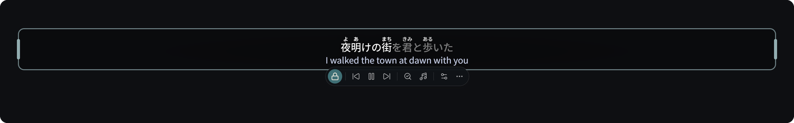
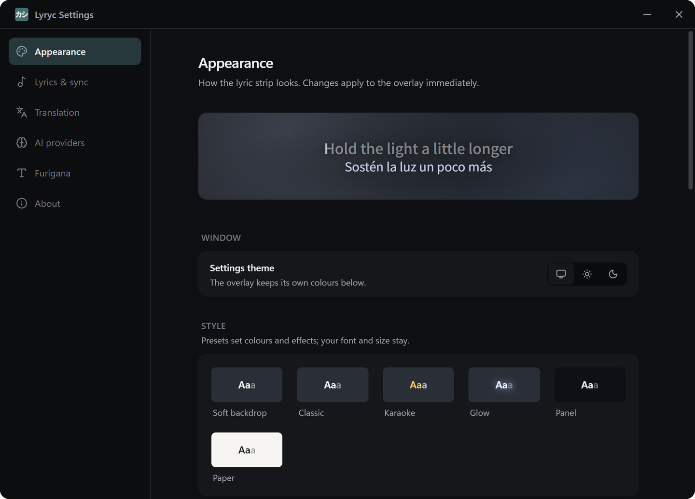

# Lyryc

Synced lyrics for the music playing in your browser, in a strip that floats over
your other windows. It can translate them, add furigana to Japanese, and
highlight each word as it's sung.


## Features

- **Stays out of your way.** Locked, the strip ignores the mouse. Hover it to show
  the Unlock button, then drag, resize or snap it to a screen edge.
- **Lyrics from several sources:** YouTube Music, [LRCLIB](https://lrclib.net/),
  and optionally QQ Music, NetEase and Kugou. Covers and remixes find the
  original's lyrics.
- **Translation with your own AI provider:** OpenAI, Anthropic, Gemini,
  OpenRouter, Groq, DeepSeek, Mistral, xAI, or a local Ollama or LM Studio. You
  can pick a backup for songs your model declines.
- **Furigana for Japanese,** and **word-by-word highlighting** when the lyrics
  are word-timed. Word timing can also be worked out on your machine.
- **Ready before the song starts:** on YouTube Music, the next songs in your
  queue are looked up and translated in advance.
- **Your style:** font, colours, glow and background, with a live preview.
- **Updates itself** from GitHub Releases.



Lyryc works fully with YouTube Music. With Spotify Web, Apple Music (web) and
SoundCloud it detects the track and shows lyrics. Builds are Windows only.

## Install

1. From the [latest release](https://github.com/Error0229/Lyryc/releases/latest),
   download and run `Lyryc_<version>_x64-setup.exe`. It doesn't need admin rights.
2. Download and unzip `lyryc-extension.zip`. In `chrome://extensions` (or
   `edge://extensions`), turn on **Developer mode**, click **Load unpacked** and
   pick the folder.
3. Reload the music tab. The extension only sees tabs opened or reloaded after
   it's installed.

The first time, the strip opens unlocked so you can place it. Lock it once it's
where you want it.

To translate, add a provider under **Settings → AI providers**, then turn on
**Translation**.

The app updates itself; the extension doesn't. After an update, unzip the new
`lyryc-extension.zip` over the old folder and click reload on `chrome://extensions`.



## Shortcuts

| | |
| --- | --- |
| **Ctrl+Shift+D** | Lock or unlock the strip |
| **Ctrl+Shift+M** | Show or hide the lyrics |
| **Esc** | Lock again |

The tray icon's menu does the same, and opens Settings.

## Privacy

API keys are kept in your system's credential store (Windows Credential Manager,
macOS Keychain, or Secret Service on Linux), not in Lyryc's settings file, and go
only to their own provider. That keeps them out of backups and synced folders,
but a program already running as you can still read them; a key with a spending
limit is safest. With no working keyring, Lyryc falls back to plain text in
`llm-settings.json` and says so in Settings. A plain
`http://` address (a local Ollama or LM Studio) sends the key unencrypted. Your AI provider gets song titles and the lyrics you
translate. Lyrics lookups send the title, artist and length to the lyrics sites.
Word timing downloads the song's audio, aligns it locally and deletes it. The
extension talks only to the app, on `localhost:8765`.

## What Lyryc remembers

A song played again costs no lookups or AI calls. Lyryc keeps what it found in
one SQLite file, `%LOCALAPPDATA%\com.lyryc.app\lyrics_cache.db`:

| What | Keyed by | Kept for |
| --- | --- | --- |
| Lyrics, "no lyrics found" and "instrumental" | artist and title | 30 days, then looked up again |
| Translations | the lyric text, languages, style, prompt and model | until you clear them |
| Word timing | the YouTube video and the lyric text | until you clear them |
| Lyrics you edited | artist and title | until you delete them |
| Which YouTube Music video a song is | artist and title | until you clear them |

- **Translations** are saved only when every line got one, so a partial answer
  is asked for again next time. A new model, style or language translates the
  song afresh. Better timing for the same words doesn't.
- **The queue lookahead** fills this cache before a song starts, so it plays
  straight from it.
- **Wrong lyrics?** **Search lyrics again** in the toolbar drops that song's
  saved lyrics and searches anew. **Mark instrumental** saves "no words" for it.
- **To fix a song,** click **Browse** under Settings → Lyrics & sync → Saved lyrics
  and translations. Open a song to edit its words, times and translation, paste
  LRC, add lyrics where none were found, or delete any part of it. Changing the
  words deletes its translation and word timing, which are made again when it
  plays.
- **Have the words but no times?** Paste them in the same place (**Paste lyrics**,
  or **Edit as text**). With word-level timing on, **Time N lines** listens to the
  song as it last played on YouTube Music and times each line, in about a
  minute. Check the times, then save.
- **To start over,** use **Clear** under Settings → Lyrics & sync → Saved lyrics
  and translations, which shows the cache's size. (**Remove downloaded files**
  there deletes the word-timing model and yt-dlp, not the cache.)

## Troubleshooting

- **Nothing shows:** reload the music tab. The extension's popup says whether
  it's connected.
- **No translation:** use **Test** next to your provider under AI providers.
  Free tiers run out quickly.
- **Anything else:** attach `%LOCALAPPDATA%\com.lyryc.app\logs\lyryc.log` to your
  report.

## Development

You need Node.js 22, Rust (stable) and the [Tauri prerequisites](https://tauri.app/start/prerequisites/).

```bash
npm install
npm run tauri dev                 # the app, hot-reloading
npm test                          # frontend tests
cd src-tauri && cargo test --lib  # backend tests
```

Load `extension/` unpacked to connect a browser. [AGENTS.md](AGENTS.md) maps the
code, and [docs/releasing.md](docs/releasing.md) covers releases.

Thanks to [LRCLIB](https://lrclib.net/), [Tauri](https://tauri.app/),
[yt-dlp](https://github.com/yt-dlp/yt-dlp), [ONNX Runtime](https://onnxruntime.ai/),
[Lindera](https://github.com/lindera/lindera) with [UniDic](https://clrd.ninjal.ac.jp/unidic/),
[pinyin](https://github.com/mozillazg/rust-pinyin) and [Symphonia](https://github.com/pdeljanov/Symphonia).

Word timing uses [hcxlabs/echora-kara-300m](https://huggingface.co/hcxlabs/echora-kara-300m)
(CC BY-NC 4.0), converted to ONNX and used non-commercially. Its decoder and
text head here are our own implementations, written from a behavioural spec.
